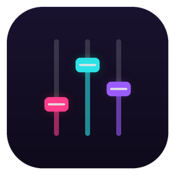
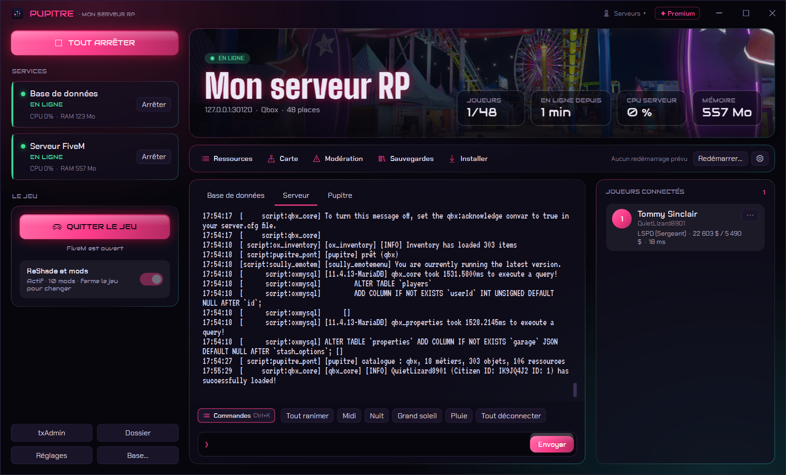
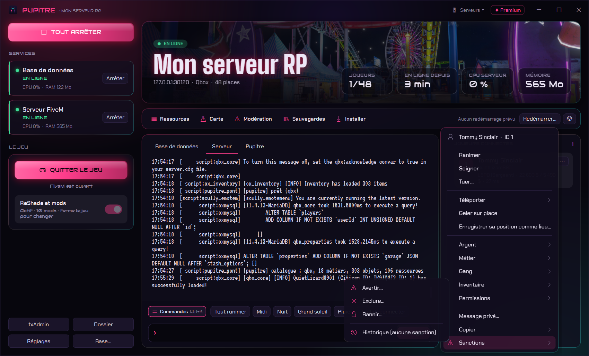
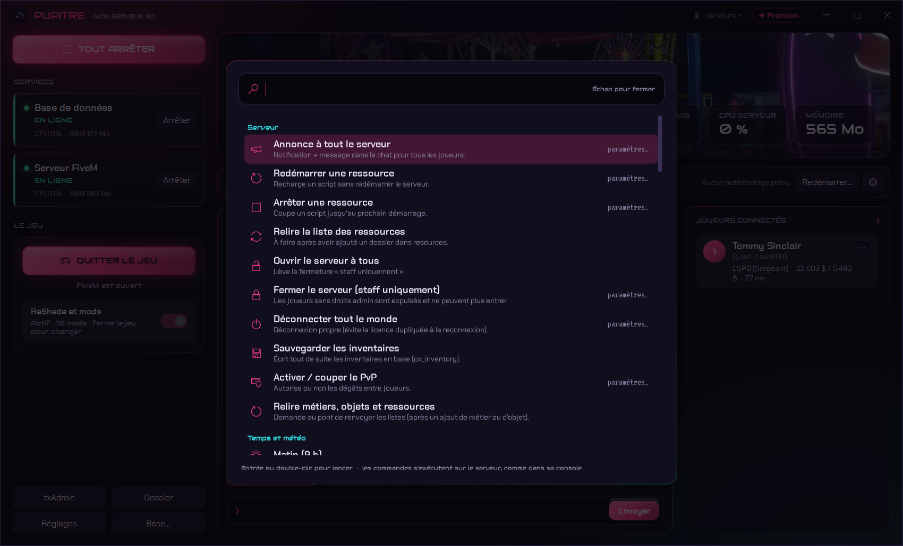
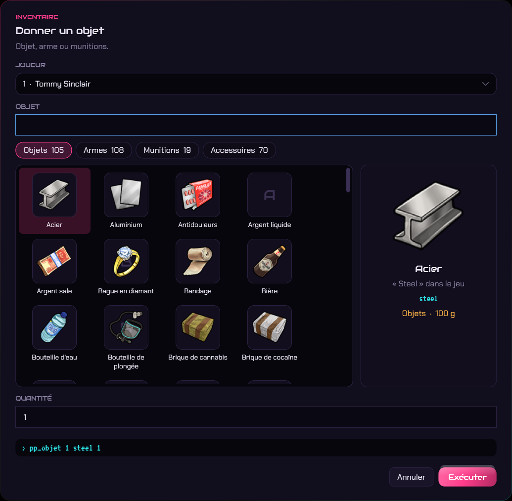
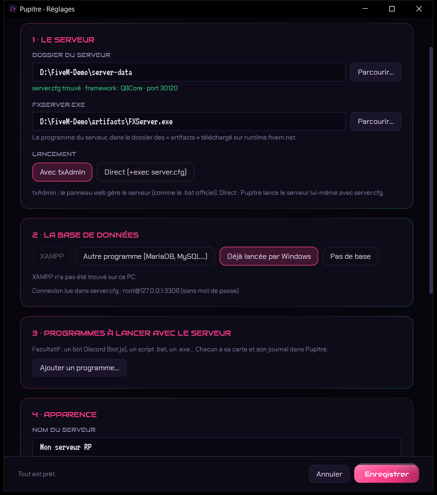

# Pupitre

### Votre serveur FiveM, piloté depuis une seule fenêtre.

*Base de données, serveur, bots, journaux, joueurs et commandes : tout se lance d'un clic et se gère à la souris, sans console ni fenêtres noires.*

 

 

<i>Le serveur en ligne : services à gauche, journal en direct au centre, joueurs connectés à droite.</i>

  

[**Pourquoi**](#-pourquoi-pupitre-) · [**Fonctionnalités**](#-fonctionnalités) · [**En images**](#%EF%B8%8F-en-images) · [**Télécharger**](#%EF%B8%8F-télécharger) · [**Questions fréquentes**](#-questions-fréquentes)

 

---

## 💡 Pourquoi Pupitre ?

Faire tourner un serveur FiveM chez soi, c'est souvent trois fenêtres noires : XAMPP ou MariaDB, le serveur, un bot Discord. On les lance dans le bon ordre, on tape des commandes en anglais, on cherche l'identifiant d'un joueur dans un journal qui défile.

**Pupitre remplace tout ça.** Un bouton démarre la base, les programmes et le serveur dans le bon ordre. Les joueurs connectés s'affichent avec leur personnage, leur métier et leur argent. Un clic droit suffit pour ranimer, téléporter, donner un objet ou un métier.

Il fonctionne avec **Qbox**, **QBCore** et **ESX**, détectés automatiquement, avec ou sans **txAdmin**.

 

## ✨ Fonctionnalités

<table>
<tr>
<td width="50%" valign="top">

### ▶️ Tout démarrer d'un clic
- **Base de données** : XAMPP lancé **en arrière-plan, sans son panneau**, MariaDB ou MySQL portable, ou base déjà gérée par Windows.
- **Programmes annexes** : bot Discord (bot.js), script .bat, .exe…
- **Serveur** avec txAdmin ou en direct (`+exec server.cfg`).
- Arrêt propre : les joueurs sont déconnectés avant l'arrêt, pour éviter l'erreur de licence en double à la reconnexion.
- **Constructeur de base** : crée la base et un compte MySQL dédié, importe les fichiers .sql de vos ressources dans le bon ordre et met à jour `server.cfg`.

</td>
<td width="50%" valign="top">

### 👥 Les joueurs sous la main
- Liste en direct : **personnage, métier, gang, argent, ping**.
- **Clic droit** : ranimer, soigner, téléporter (lieux ou joueurs), geler, argent, métier et grade, gang, objets, permissions, message privé, expulsion.
- **Enregistrer la position** d'un joueur comme nouveau lieu de téléportation.

</td>
</tr>
<tr>
<td width="50%" valign="top">

### ⌨️ Toutes les commandes en français
- **Palette** (Ctrl+K) avec recherche : annonce, ressources, heure, météo, panne de courant, PvP…
- **Fermer le serveur au public** pour une maintenance (seul le staff peut entrer).
- Console libre avec historique, journal par service.

</td>
<td width="50%" valign="top">

### 🎒 Pensé pour votre serveur
- Métiers, gangs, objets et ressources **lus directement dans votre serveur**.
- Objets en **grille avec leurs images** (ox_inventory, qb-inventory…) et noms en français.
- **Nom du serveur, couleur et bannière** à votre image.

</td>
</tr>
</table>

 

## 🖼️ En images

<table>
<tr>
<td width="50%" align="center">
 
<b>1 · Clic droit sur un joueur</b> Toutes les actions, jusqu'aux lieux de téléportation.
</td>
<td width="50%" align="center">
 
<b>2 · Palette de commandes</b> Ctrl+K, tapez quelques lettres, Entrée.
</td>
</tr>
<tr>
<td width="50%" align="center">
 
<b>3 · Donner un objet</b> On voit ce qu'on donne : image, nom, poids.
</td>
<td width="50%" align="center">
 
<b>4 · Assistant au premier lancement</b> Framework, base, port et FXServer détectés tout seuls.
</td>
</tr>
</table>

 

## ⬇️ Télécharger

### [**➜ Page de téléchargement (dernière version)**](https://github.com/lerapeurdu62280-debug/Pupitre-Download/releases/latest)

| Fichier | Pour qui ? |
|---|---|
| **`Pupitre-Setup.exe`** | Installation classique, avec raccourci dans le menu Démarrer. **Recommandé.** |
| **`Pupitre-Portable.exe`** | Aucune installation : un seul fichier, à lancer depuis n'importe quel dossier. |

> **Windows affiche « Windows a protégé votre ordinateur » ?** C'est normal pour un logiciel récent. Cliquez sur **Informations complémentaires**, puis sur **Exécuter quand même**.

### 🖥️ Configuration requise
- **Windows 10 ou 11**, 64 bits. Rien d'autre à installer.
- Un serveur FiveM installé sur ce PC (dossier avec `server.cfg` et `resources`, plus `FXServer.exe`).
- Framework **Qbox**, **QBCore** ou **ESX** pour les fonctions argent, métier et objets. Sans framework, le reste fonctionne.

 

## 🚀 En trois gestes

1. **Lancez Pupitre** et indiquez le dossier de votre serveur : le framework, FXServer, la base de données et le port sont détectés.
2. **Laissez cochée l'installation du pont** : Pupitre ajoute sa petite ressource au serveur et deux lignes à la fin de `server.cfg` (une copie de sauvegarde est faite avant).
3. Cliquez sur **« Tout démarrer »**. Quand le serveur est en ligne, **« Jouer »** ouvre FiveM et vous connecte.

 

## ❓ Questions fréquentes

<b>Pupitre est-il vraiment gratuit ?</b>

 
Oui, sans limite de joueurs ni de fonctions.

<b>Que modifie Pupitre dans mon serveur ?</b>

 
Une seule chose, et seulement si vous le laissez faire : il copie la ressource <code>pupitre_pont</code> dans <code>resources\[pupitre]</code> et ajoute à la fin de <code>server.cfg</code> les lignes <code>ensure pupitre_pont</code> et <code>add_ace resource.pupitre_pont command allow</code>. Une copie de <code>server.cfg</code> est faite juste avant. Pour revenir en arrière, supprimez ces deux lignes et le dossier.

<b>Le pont ouvre-t-il quelque chose sur Internet ?</b>

 
Non. Pupitre et le pont communiquent par de simples fichiers dans le dossier du serveur (<code>commandes.txt</code>, <code>joueurs.json</code>, <code>catalogue.json</code>). Aucun port n'est ouvert, rien ne sort de votre PC.

<b>Je pars de zéro : comment créer la base du serveur ?</b>

 
Cliquez sur <b>Base…</b> : le constructeur crée la base et un compte MySQL réservé au serveur, retrouve tous les fichiers .sql de vos ressources (ESX, QBCore, Qbox, inventaires, jobs…) et les importe dans le bon ordre, le cœur du framework d'abord. Les lignes déjà présentes sont ignorées, on peut donc le relancer sans risque. Il met enfin à jour <code>mysql_connection_string</code> dans <code>server.cfg</code>, après une copie de sauvegarde.
  
Il repère aussi les tables du jeu importées par erreur dans la base interne « mysql » et les déplace, avec leurs données, dans la base du serveur.

<b>J'utilise XAMPP : faut-il ouvrir le panneau XAMPP ?</b>

 
Non. Pupitre trouve XAMPP tout seul et lance sa base MySQL en arrière-plan, sans fenêtre, ainsi qu'Apache pour que phpMyAdmin reste accessible (bouton « phpMyAdmin »). Il arrête tout proprement quand vous cliquez sur « Tout arrêter ».

<b>La météo ne change pas, ou les joueurs n'apparaissent pas.</b>

 
<b>Météo</b> : Pupitre pilote tout seul Renewed-Weathersync, qb-weathersync et vSync. Si votre serveur a un autre script météo, indiquez ses commandes console dans <b>Réglages</b> (par exemple <code>weather {0}</code> et <code>time {0} {1}</code>) : les boutons et la palette les utiliseront.
  
<b>Joueurs</b> : la liste vient du pont. L'onglet « Pupitre » signale par un ⚠ quand le serveur tourne sans l'avoir chargé, ou quand txAdmin lance le serveur depuis un autre dossier que celui réglé dans Pupitre.

<b>Pupitre fonctionne-t-il sur un serveur loué (VPS, hébergeur) ?</b>

 
Pupitre doit tourner sur le PC où se trouve le serveur. Sur un VPS Windows, installez-le directement sur le VPS. Les hébergeurs de jeux sans accès au bureau Windows ne sont pas compatibles.

<b>Que se passe-t-il si je ferme Pupitre ?</b>

 
Pupitre propose d'arrêter proprement le serveur, les programmes et la base de données avant de se fermer. Les joueurs sont déconnectés avec un message.

 

---

💬 Une question, un souci ? Rejoignez le **[Discord de l'atelier](https://discord.gg/W5hd36CW6b)**.

**Pupitre** — conçu et développé par **S.O.S INFO LUDO**

Logiciel propriétaire, tous droits réservés. FiveM et Cfx.re sont des marques de Cfx.re / Take-Two Interactive. Grand Theft Auto V est une marque de Rockstar Games. XAMPP est un projet d'Apache Friends. Ce logiciel est indépendant : il n'est affilié à aucune de ces sociétés.

